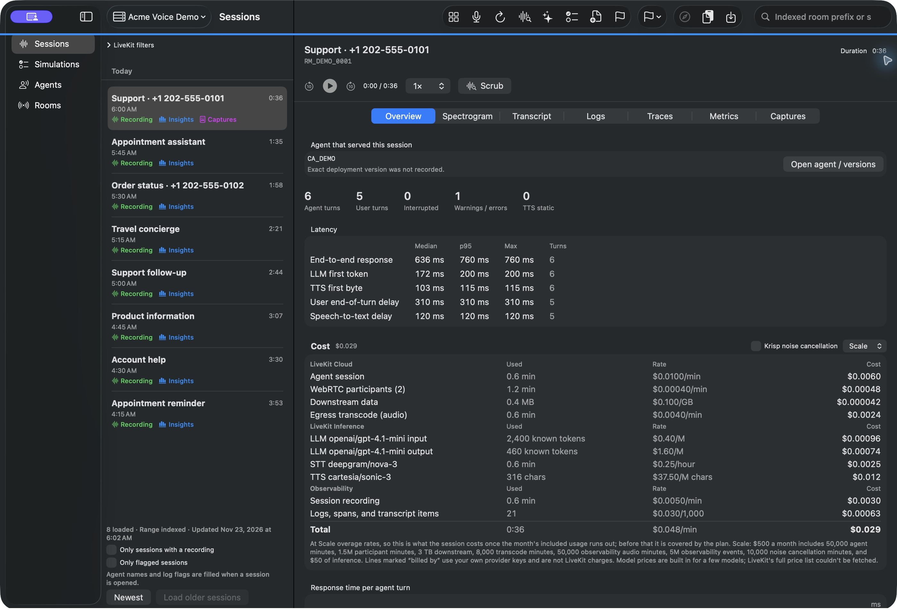
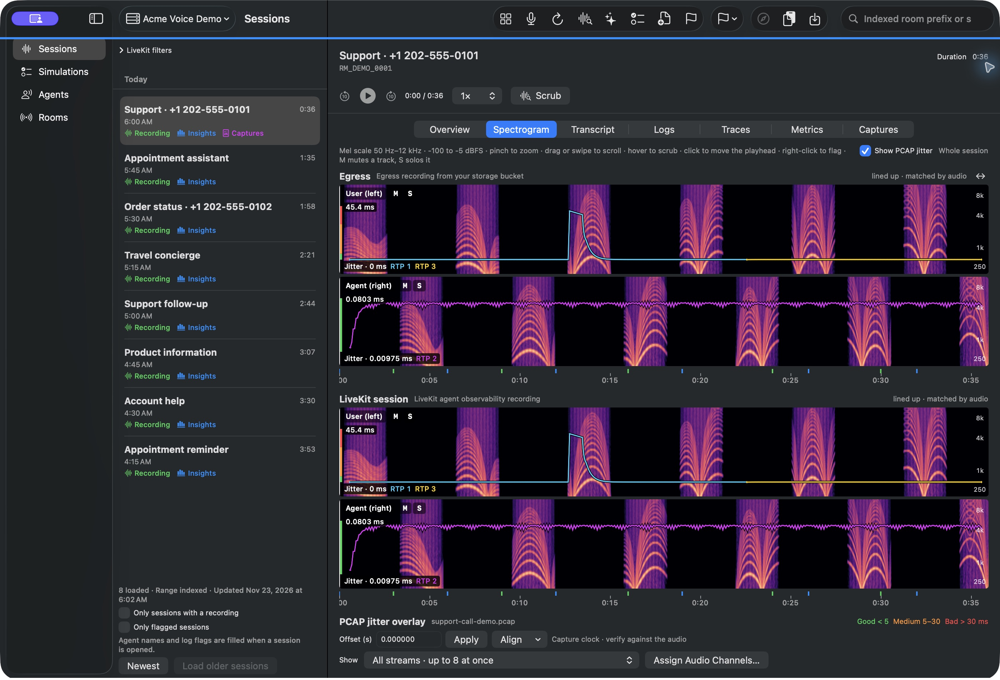
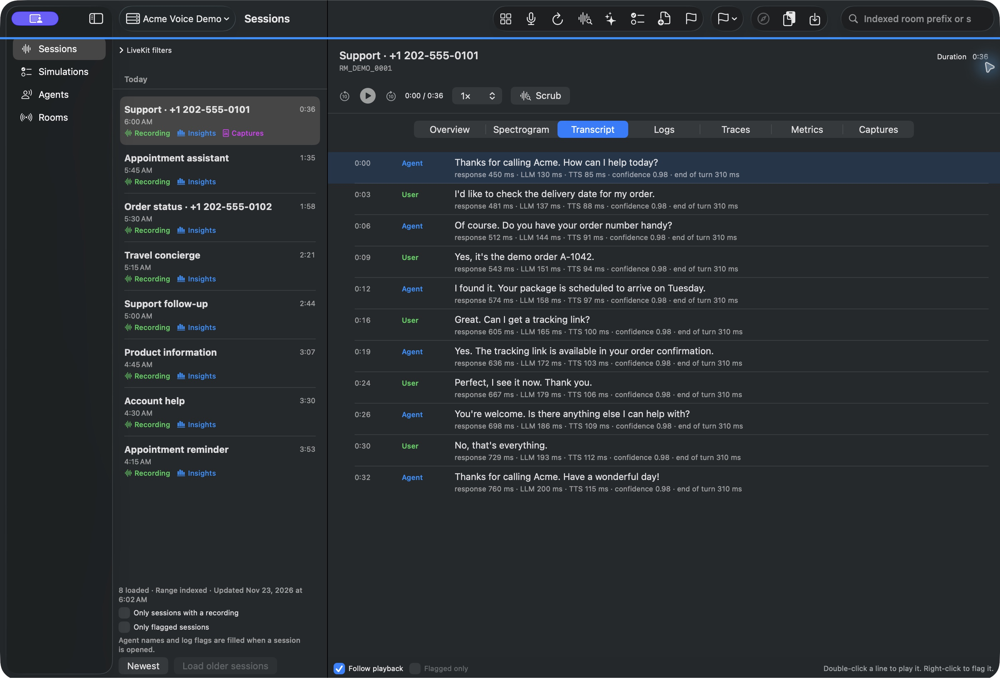
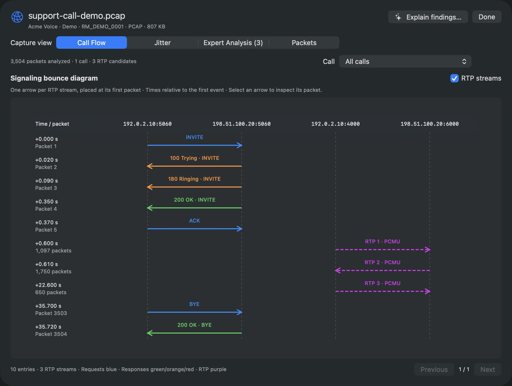
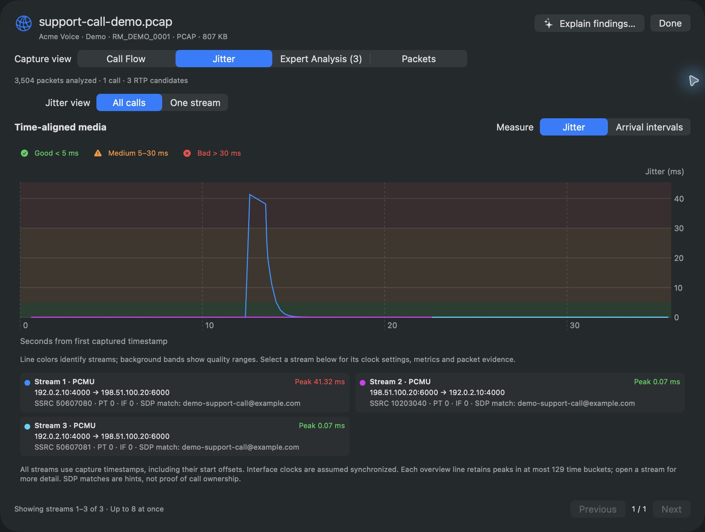
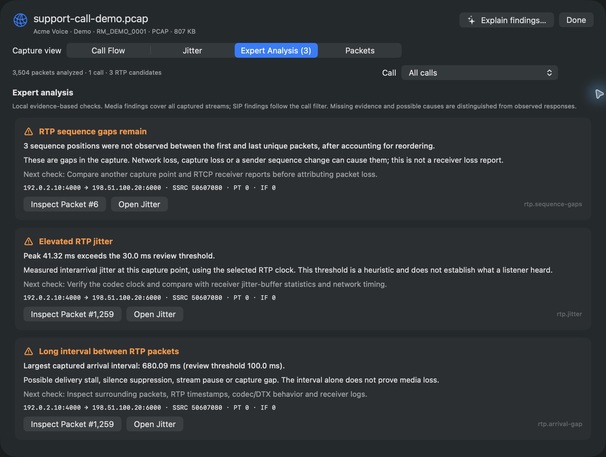

# LiveKit Observer

LiveKit Observer is a native macOS app for understanding and troubleshooting LiveKit voice agent calls. Review conversations, listen to recordings, and connect audio problems with transcripts, agent activity, and network timing—all in one place.

[Download for macOS](https://github.com/yepher/livekit-observer/releases/latest) · [Setup and usage guide](docs/guide.md)

## Screenshots

All screenshots use fictional projects, phone numbers, conversations, and generated audio and packet data. Click any image to view it at full size.

| Session overview | Spectrogram with jitter overlay |
| --- | --- |
|  |  |

| Transcript | Call flow |
| --- | --- |
|  |  |

| Jitter comparison | Expert analysis |
| --- | --- |
|  |  |

## Key features

- **Review calls in context.** Browse transcripts, logs, traces, metrics, response latency, and estimated costs together.
- **Hear and see the audio.** Compare LiveKit and egress recordings with synchronized playback, per-channel mel spectrograms, zoom, mute, and solo.
- **Connect audio and network timing.** Overlay PCAP jitter on assigned audio channels, with a shared timeline and adjustable clock alignment.
- **Debug the browser's side of a call.** Open a Chrome WebRTC internals or rtcstats dump to see the connection's route and state changes, per-stream charts of loss, jitter, and concealment, and findings with what to check next. [WEBRTC-DEBUGGER.md](WEBRTC-DEBUGGER.md) explains how to collect dumps from customers and read them.
- **Investigate packet captures.** Import PCAP or PCAPNG files for SIP call flows, directional RTP streams, color-coded jitter charts, and local expert findings with evidence and suggested next checks.
- **Handle busy projects.** Search indexed sessions, filter calls, and review multiple projects without downloading every recording.
- **Monitor live activity.** Inspect agents and rooms, join a room to hear it and follow its events, live transcript, and agent state, call an agent's RPC methods, act on participants, test an agent, and review simulation results.
- **Use optional AI assistance.** Request evidence-based session reviews, transcription comparisons, and TTS comparisons. AI features are experimental and off by default.
- **Keep useful evidence.** Flag moments, add notes, and export session data for follow-up.
